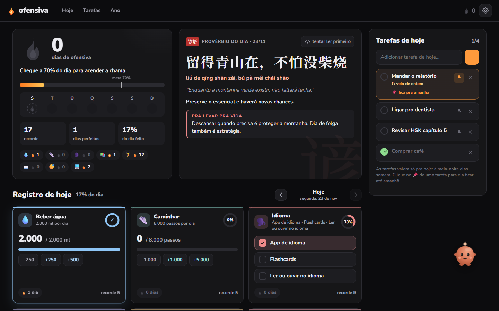

# 🔥 Ofensiva

Rastreador de hábitos **local**, em tema escuro, com ofensivas no estilo Duolingo e o ano inteiro num mapa de calor: cada hábito tem o seu gráfico, e cada quadradinho fica mais colorido conforme o quanto você cumpriu naquele dia.



## O que tem

- **Onboarding**: cada pessoa monta os próprios hábitos. Dá pra partir de sugestões (água, passos, estudo, treino, leitura, sono, meditação, idioma, projeto pessoal…) e ajustar as metas, ou criar do zero.
- **4 tipos de hábito**:
  - **Número com meta**: água em ml, passos, minutos de estudo, horas de sono. Tem botões de `+`, valor exato com um clique e cronômetro opcional. Aceita métricas alternativas (ex.: *ler 2 páginas **ou** ouvir 10 min de audiobook*). A meta também pode ser um **teto** com o total **digitado** do dia (ex.: dieta de *até 2.000 kcal*: ficou dentro, conta; passou, a barra fica vermelha e a ofensiva não fecha).
  - **Checklist**: um hábito com várias partes (ex.: idioma = app + flashcards + leitura). Quanto mais você marca, mais colorido fica o dia.
  - **Sim ou não**: com etiquetas opcionais (ex.: Push/Pull/Legs) e **dia de descanso**, que não quebra a ofensiva.
  - **Níveis**: nada / um pouco / tudo, com campo de anotação.
- **Ofensiva estilo Duolingo**: a chama geral (dias em que você fez pelo menos X% do dia; o X você ajusta), a semana com as chamas, recorde, dias perfeitos e a ofensiva de cada hábito.
- **Ano em revisão**: um mapa de calor por hábito, mais um da ofensiva geral. Passe o mouse para ver o detalhe do dia, clique para abrir e editar aquele dia.
- **Tarefas do dia**: elas somem à meia-noite. Só segue para o dia seguinte a tarefa em que você clicar no 📌 (e o 📌 vale por uma virada; no outro dia você decide de novo). O botão **→S** manda uma tarefa para a semana.
- **Tarefas da semana**: valem de segunda a domingo e vão **ficando mais vermelhas** conforme a semana passa. No fim da semana, só seguem para a próxima as que você marcar com **↻**; as que acumulam já começam mais "quentes". O botão **→H** traz uma tarefa para hoje.
- **Pomodoro com tags de matéria**: modo foco em tela cheia, com anel animado, ciclos, pausa curta e longa, modo livre (cronômetro), presets 25/5, 50/10 e 90/15, **pausa rápida 🚻** (pausa alguns minutos e retoma sozinha), notificação, título da aba com o tempo e uma pílula flutuante quando minimizado. Cada sessão registra a matéria (e o assunto), e os minutos somam sozinhos no seu hábito de estudo. Tem estatísticas de hoje e da semana por matéria.
- **Estéticas por matéria**: Chinês (vermelho e dourado, mostrador com as 12 horas chinesas 子丑寅卯…, 专注/休息), Matemática (papel quadriculado e ∑∫π flutuando), Código/IA (terminal neon), Bio/DNA (A·T·C·G) e Visualização (cores vivas). O tema é escolhido automaticamente pelo nome da matéria e dá pra trocar.
- **Matérias**: uma aba (`#materias`) para organizar cada matéria da faculdade em assuntos e subtópicos, marcando o que já viu. Colar uma lista cria vários de uma vez (útil para copiar a ementa). O 🍅 de um assunto abre o modo foco direto nele.
- **Horóscopo chinês do dia**: seu animal e elemento pelo ano de nascimento (o ano vira no 立春, ~4/fev); o pilar do dia (干支); as relações tradicionais entre o animal do dia e o seu (六合, 三合, 冲, 刑, 害); e a interação dos cinco elementos. Com chave da API, o Claudinho escreve a leitura do dia ligando com os seus hábitos.
- **Provérbio chinês do dia**: hanzi, pinyin, tradução e uma lição pra levar pra vida. Tem o modo "tentar ler primeiro", que borra o pinyin e a tradução até você clicar.
- **Claudinho**: um mini Claude que passeia pela tela. Ele reage quando você fecha um hábito ou garante a ofensiva, e você pode conversar com ele. Com uma chave da API da Anthropic ele lê o seu dia e responde de forma específica; sem chave, usa frases prontas.

## Seus dados (e como não perder nada)

Tudo fica no seu computador, em `dados/estado.json` (nunca vai para o git). Para não perder nada:

- **Gravação atômica**: escreve num arquivo temporário e troca de uma vez; se o PC desligar no meio, o arquivo anterior continua inteiro.
- **Backups em `dados/backups/`**: um por dia (últimos 120 dias) e **um por mês para sempre**.
- **Snapshot de proteção** (`protecao-*.json`) antes de qualquer gravação que diminua os dados, como apagar um hábito ou um import errado.
- **Nunca troca dados por um estado vazio**: o servidor recusa.
- **Arquivo corrompido?** Ele é separado e o app se recupera sozinho do backup mais novo.
- **Servidor fora do ar?** O navegador guarda suas mudanças e as reenvia quando ele voltar.
- **Cópia em outro lugar**: defina `OFENSIVA_BACKUP_EXTRA` (por exemplo, uma pasta do OneDrive ou do Google Drive) para espelhar o estado e os backups lá também.

## Como rodar

Precisa do [Node.js](https://nodejs.org) 20.12 ou mais novo.

```bash
git clone https://github.com/Fabio-araujo-silva/ofensiva.git
cd ofensiva
npm install
npm start
```

Abra **http://localhost:4848**. No Windows, dá pra dar dois cliques em `iniciar.bat`: se o servidor já estiver no ar, ele só abre a página; se não, sobe o servidor e abre o navegador assim que estiver pronto. Para um atalho na Área de Trabalho, aponte para o `iniciar.bat` (o ícone está em `docs/ofensiva.ico`).

### Claudinho com a Claude API (opcional)

Cole sua chave em **Ajustes → Claudinho**, ou crie um `.env` a partir do `.env.example`:

```
ANTHROPIC_API_KEY=sk-ant-...
```

A chave fica só na sua máquina e as chamadas saem do servidor local, nunca do navegador. O modelo padrão é o `claude-opus-5-5` (troque com `CLAUDE_MODELO`). Cada fala é curta, então o custo por mensagem é de frações de centavo.

### Ver com dados de exemplo

```bash
npm run demo
```

Sobe em **http://localhost:4849** com uns 10 meses de dados inventados, numa pasta separada (`dados-demo/`). Seus dados de verdade não são tocados.

## Configuração

| Variável | Padrão | Para quê |
|---|---|---|
| `PORTA` | `4848` | porta do servidor |
| `HOST` | `127.0.0.1` | troque para `0.0.0.0` para abrir no celular pela rede local (sem senha!) |
| `OFENSIVA_DADOS` | `dados` | pasta dos dados |
| `ANTHROPIC_API_KEY` | — | chave do Claudinho |
| `CLAUDE_MODELO` | `claude-opus-5-5` | modelo do Claudinho |
| `OFENSIVA_BACKUP_EXTRA` | — | pasta extra para espelhar estado e backups (ex.: OneDrive) |

## Estrutura

```
server.js            servidor HTTP (estáticos + /api/estado + /api/claudinho)
public/
  index.html, estilo.css
  js/app.js          telas: ofensiva, provérbio, registro, tarefas, ano
  js/habitos.js      modelo: progresso, ofensivas, descrições (sem DOM)
  js/onboarding.js   boas-vindas e escolha dos hábitos
  js/ajustes.js      ajustes e editor de hábito
  js/claudinho.js    o mascote e as falas
  js/semana.js       tarefas da semana
  js/pomodoro.js     pomodoro, modo foco e estatísticas
  js/temas.js        estéticas do modo foco por matéria
  js/materias.js     aba de matérias, assuntos e subtópicos
  js/horoscopo.js    calendário 干支 e relações do horóscopo chinês
  js/proverbios.js   70+ provérbios com pinyin e tradução
  js/sugestoes.js    sugestões do onboarding
scripts/demo.mjs     dados de exemplo
```

## Licença

MIT
